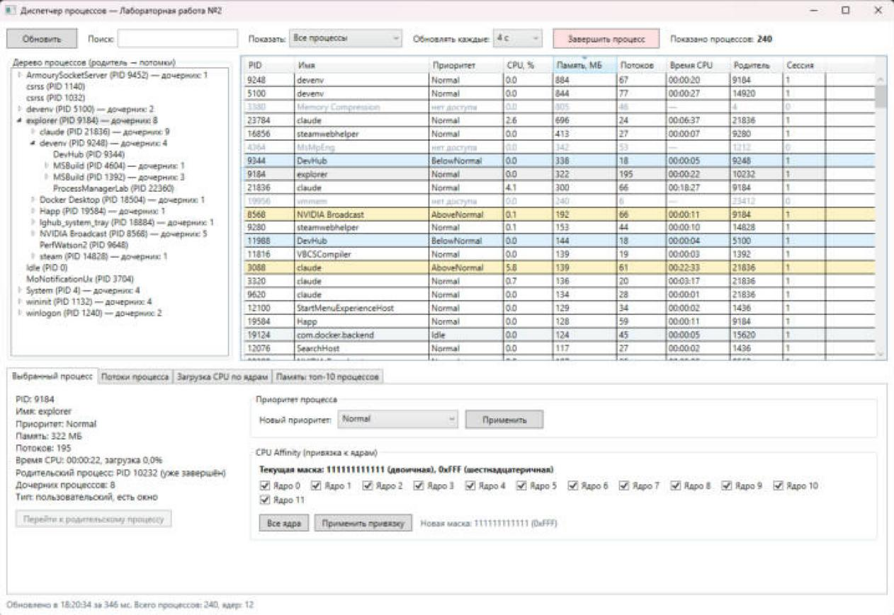
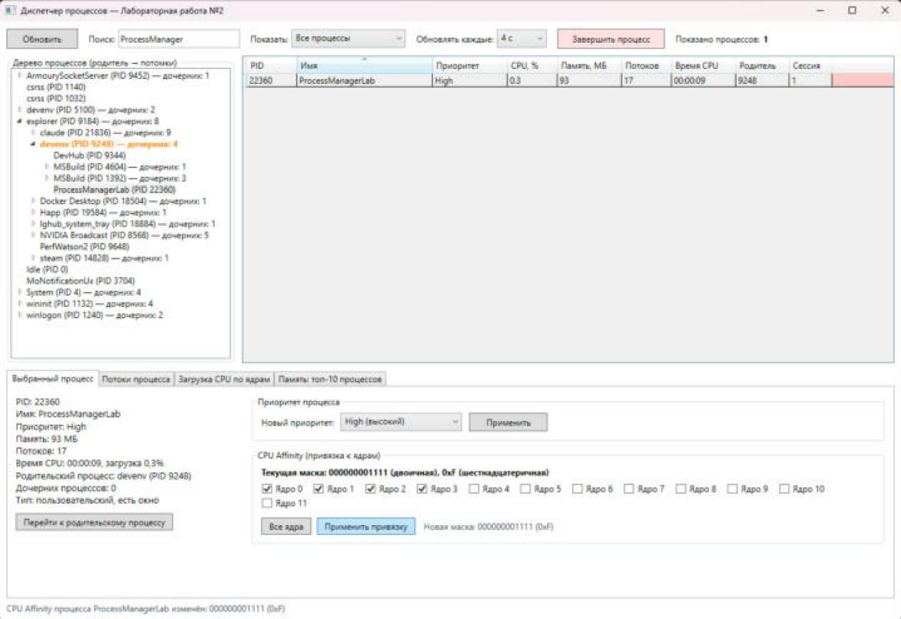
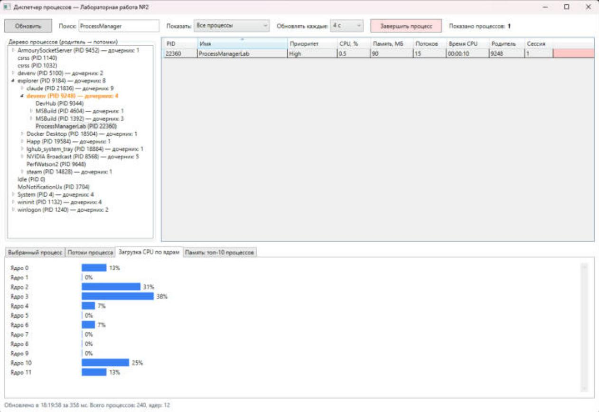

# Диспетчер процессов — Лабораторная работа №2

**WPF-приложение для управления процессами Windows**  
с изменением приоритета, привязкой к ядрам и деревом иерархии 🚀



## Что умеет приложение

- Список **всех** процессов (включая системные, к которым нет доступа) с автообновлением, интервал 2/4/10/30 секунд
- Колонки: PID, имя, приоритет, загрузка CPU %, память (МБ), потоки, время CPU, родительский PID, сессия; сортировка по любой колонке
- **Поиск** по имени или PID и **фильтры**: все / только с окнами (GUI) / только системные
- **Изменение приоритета** — 6 уровней от Idle до RealTime, с предупреждением для RealTime и понятными сообщениями при нехватке прав
- **Цветовое выделение** процессов с высоким (High, RealTime, AboveNormal) и низким приоритетом
- **CPU Affinity** — чекбоксы для каждого ядра, текущая и новая маска в двоичном и шестнадцатеричном виде
- Таблица **потоков** процесса — ID, приоритет, состояние (с причиной ожидания), время CPU
- **Дерево процессов** — иерархия родитель → потомки, количество дочерних процессов, выделение родителя выбранного процесса, раскрытые ветки не сворачиваются при обновлении
- **Завершение процесса** с подтверждением и отдельным предупреждением для системных процессов
- **Диаграммы**: загрузка CPU по каждому ядру и топ-10 процессов по памяти
- Получение данных выполняется в фоновом потоке, родительские процессы берутся одним WMI-запросом — интерфейс не подвисает

## Как запустить проект

1. Откройте **Visual Studio** (Community 2022 или новее)  
2. Установите .NET Framework 4.8 (если не установлен)  
3. Откройте файл решения: `ProcessManagerLab.slnx`  
4. Нажмите **F5** или запустите `ProcessManagerLab\bin\Debug\ProcessManagerLab.exe` (для управления системными процессами — от имени администратора)

## Требования

- **Язык программирования:** C# 7.0 и выше
- **Фреймворк:** .NET Framework 4.8
- **Операционная система:** Windows 10 / Windows 11
- **Дополнительная сборка:** System.Management (для WMI-запросов)

## Структура проекта

```text
ProcessManagerLab/
├── Models/
│   ├── ProcessInfo.cs          модель процесса (PID, имя, приоритет, память, потоки, CPU, affinity, дети)
│   ├── ThreadInfo.cs           модель потока
│   └── ChartBar.cs             столбец диаграммы
├── Services/
│   ├── ProcessService.cs       список процессов, SetPriority, SetAffinity, Kill, потоки, загрузка ядер
│   └── ProcessParentHelper.cs  WMI: ParentProcessId всех процессов одним запросом
├── Utilities/
│   └── AffinityHelper.cs       битовая маска ядер: двоичный и 16-ричный вид
├── MainWindow.xaml(.cs)        интерфейс: дерево, таблица, вкладки управления и диаграммы
└── App.xaml(.cs)               точка входа
```

## Скриншоты

| Привязка к ядрам (CPU Affinity) | Загрузка по ядрам |
|------|------|
|  |  |

## Отчёт

[docs/Отчёт_лаба2.docx](docs/Отчёт_лаба2.docx)

## Автор

Ростовцев Д. А.  
Группа Б.ИВТ.ПРОМ.23.01  
Тверской государственный технический университет  
Тверь, 2026 г.
